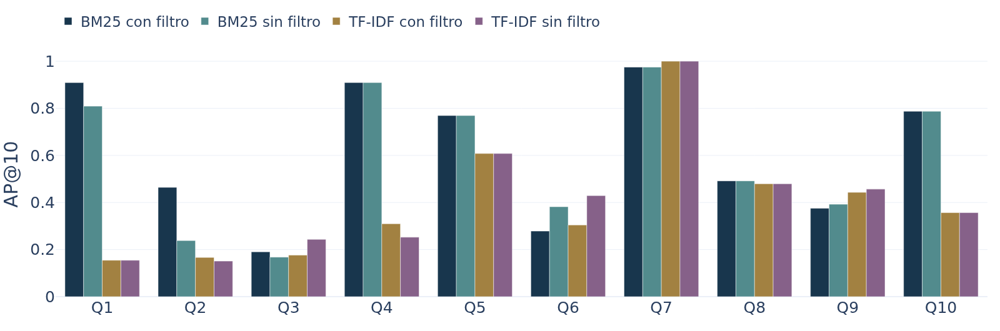

# Examen 1 — Minería de Textos

Universidad Nacional Autónoma de México

Facultad de Estudios Superiores Acatlán

Licenciatura en Ciencia de Datos

Alumno: Luis Alfredo Ramírez Maza

Asignatura: Minería de Textos. Fecha: 11 de noviembre de 2026.

Repositorio personal de GitHub: pendiente de publicación autorizada.

## 1. Resumen y objetivos

Se desarrolla un sistema de recuperación y extracción de información sobre conferencias presidenciales. A partir de pasajes con identidad y texto verificables, se comparan TF-IDF y BM25, con y sin filtro temporal; posteriormente se combinan reglas y un reconocedor de entidades en español para construir respuestas con evidencia. El objetivo general es recuperar información pertinente y distinguir las menciones textuales de las relaciones que pueden justificarse. Los objetivos específicos son construir un índice invertido, evaluar los rankings con juicios humanos, evaluar entidades con un Gold independiente y conservar citas, offsets y trazabilidad de las respuestas.

En esta colección, BM25 con filtro obtiene MAP de 0.6150 y el sistema combinado alcanza F1 oficial de 0.7066. La evidencia se conserva aunque la respuesta sea incompleta: de 451 filas, 126 están respaldadas en texto, 322 son ambiguas y tres carecen de evidencia suficiente. Estas cifras proceden de resultados_ir.csv, resultados_ie.csv y 10_validacion_h8.json en salida/. Las valoraciones de las respuestas corresponden al alumno y se distinguen de las métricas automáticas.

## 2. Corpus, limpieza y segmentación

La fuente es carevies/discursos_AMLO, revisión 2c463bb3d5bf58742b4d842917da1211c44d2e18 de Hugging Face [4]. Contiene 2,294 discursos entre el 2 de diciembre de 2018 y el 30 de septiembre de 2024. La conversión conserva el orden original y asigna identificadores estables. Los archivos de auditoría 01_estadisticas_corpus.json y 01_limpieza.json documentan las operaciones de la tabla 1.

<!-- tabla: corpus -->

Las marcas reales de interlocutor requieren canonización, pues su formato difiere del supuesto por el kit. Se conserva el texto canónico completo para citar y anotar; inicio_cuerpo separa la marca del contenido que se indexa. Se mantienen las intervenciones de reporteros, pero el mínimo de longitud elimina el 64.94 % de sus intervenciones cortas. Los reporteros representan el 15.53 % de los pasajes conservados. Esto restringe las preguntas breves que el buscador puede recuperar y debe considerarse al interpretar su cobertura. No se realizó el experimento opcional de sensibilidad de ventanas.

<!-- pagina -->

## 3. Preprocesamiento e índice invertido

El índice utiliza el cuerpo del pasaje: tokenización, normalización de caja y acentos, stopwords en español y stemming. La lista adicional elimina expresiones repetidas de la estenografía, como presidente, pregunta y gracias. La marca permanece visible en el texto, pero sus tokens quedan fuera del índice; cambiarla no debe alterar el ranking. Las transformaciones del índice no sustituyen el texto sobre el que se calculan los offsets de entidades.

El índice registra la frecuencia de cada término por pasaje. Contiene 35,891 términos y 7,238,490 postings; la longitud media tras preprocesamiento es 72.21 tokens. La frecuencia documental se contrastó con CountVectorizer. La tabla 2 reproduce cuatro ejemplos de salida/02_postings.md: cada pareja indica el identificador del pasaje y su frecuencia, con tres postings por término. El índice completo se reconstruye desde los textos y la configuración fijada.

<!-- tabla: postings -->

## 4. Modelos y evaluación de recuperación

TF-IDF utiliza frecuencia sublineal, idf suavizada y normalización L2, equivalentes a las opciones sublinear_tf y smooth_idf de scikit-learn. La consulta se representa en el mismo espacio y se ordena por similitud coseno:

$$
w_{t,p}=(1+\ln tf_{t,p})\left(\ln\frac{1+N}{1+df_t}+1\right),\qquad \cos(q,p)=\frac{q\cdot p}{\|q\|_2\|p\|_2}.
$$

BM25 [1] pondera la rareza y satura la contribución de la frecuencia, ajustándola a la longitud del pasaje, con $k_1=1.5$ y $b=0.75$:

$$
\mathrm{idf}(t)=\ln\left(1+\frac{N-df_t+0.5}{df_t+0.5}\right),\quad
s(q,p)=\sum_{t\in U(q)}\mathrm{idf}(t)\frac{tf_{t,p}(k_1+1)}{tf_{t,p}+k_1(1-b+b|p|/\mathrm{avgdl})}.
$$

La suma utiliza términos únicos de la consulta. A diferencia de BM25Okapi de rank_bm25, cuya idf es $\ln\frac{N-df_t+0.5}{df_t+0.5}$ con piso $\varepsilon$ para términos muy frecuentes, la variante implementada suma uno dentro del logaritmo para conservar pesos positivos. El filtro temporal restringe las fechas inclusivas antes de seleccionar los diez primeros, sin cambiar los parámetros ni expandir consultas.

La longitud tras preprocesamiento varía entre cuatro y seis tokens y no explica por sí sola qué modelo gana: Q4 favorece a BM25 y Q9 a TF-IDF, ambas con cinco. Alias como Dos Bocas/refinería Olmeca y AIFA/Santa Lucía limitan la coincidencia léxica. Embeddings podrían recuperar paráfrasis, pero no se ejecutó ese experimento y no se afirma una mejora numérica.

<!-- pagina -->

### Evaluación IR y selección del ganador

El pool reúne los top-10 de las cuatro variantes. Luis realizó personalmente 176 juicios temáticos: 113 relevantes y 63 no relevantes; su transferencia autorizada conserva la revisión 197 y la cobertura completa. La fecha no forma parte del juicio temático. El evaluador original calcula P@5, P@10 y AP@10; su denominador es el total de relevantes del pool de la consulta, incluidos los no recuperados:

$$
P@k=\frac{\sum_{r=1}^{k}rel(r)}{k},\qquad AP@10=\frac{\sum_{r=1}^{10}P@r\,rel(r)}{R_q},\qquad MAP=\frac{1}{10}\sum_{q=1}^{10}AP_q.
$$

<!-- tabla: ir -->

La vista oficial determina el ganador; la vista con ventana relabela técnicamente como no relevantes las filas fuera del intervalo y modifica el denominador. Se presenta como auditoría complementaria, sin sustituir los juicios originales. BM25 con filtro supera a TF-IDF con filtro en MAP oficial (0.6150 frente a 0.3998, tabla 3). La regla fijada selecciona el mayor MAP entre variantes con filtro y favorece a BM25 únicamente en empate; aquí no fue necesario desempatar.

La ventaja depende de la consulta: BM25 obtiene AP de 0.9091 frente a 0.1545 en Q1 y 0.9094 frente a 0.3095 en Q4. TF-IDF supera a BM25 en Q6 (0.3043 frente a 0.2785), Q7 (1.0000 frente a 0.9750) y Q9 (0.4431 frente a 0.3752). Q3 presenta AP bajo en ambos (0.1762 y 0.1903). Estas diferencias proceden de 05_ir_ganador_por_consulta.csv, sin atribuir causalidad a un rasgo aislado.

<!-- pagina -->

## 5. Extracción con reglas, gazetteers y BETO

Las reglas detectan fechas y dinero sobre el texto completo; los gazetteers aportan ORG y LOC. Las colisiones se resuelven por longitud y prioridad. Las regex no cubren toda fecha escrita en palabras ni todo monto sin unidad inequívoca. La revisión humana de once candidatos no aprobó ampliaciones: se conservaron 76 entradas. Los 1,505 candidatos originales siguen auditados; los no seleccionados permanecen sin revisar.

El NER es mrm8488/bert-spanish-cased-finetuned-ner, basado en BERT [2] y BETO [3], con revisión b11721d41d9e948da32fcdabeeef4fb0f3ebcdf7. Se eligió por criterios técnicos antes del Gold, sin comparar modelos sobre ese conjunto. El pipeline conserva cachés crudas, proyecta offsets de los fragmentos y une spans según la política documentada. No aporta FECHA ni MONTO; las cantidades no monetarias son auxiliares separados de las entidades oficiales.

La normalización no modifica las fronteras anotadas: valida fechas, mantiene su precisión y representa dinero con unidades y moneda cuando hay evidencia. No convierte divisas ni suma inversiones entre eventos. La fusión une únicamente coincidencias exactas de tipo, inicio y fin; conserva discrepancias y solapes parciales para auditoría.

## 6. Gold y evaluación de entidades

La muestra ciega fijada con semilla 42 contiene veinte pasajes únicos, dos por consulta. Luis anotó personalmente 138 entidades en un auxiliar externo, importadas con validación y autorización; cerró el Gold en Streamlit antes de mostrar predicciones. El pasaje 1133_87 permanece revisado sin entidades. No se sustituyeron negativos ni se ajustaron reglas o pesos con etiquetas Gold.

Una predicción es correcta solo si coincide exactamente en pasaje, tipo e inicio/fin, con inicio inclusivo y fin exclusivo. Se calculan $P=TP/(TP+FP)$, $R=TP/(TP+FN)$ y $F_1=2PR/(P+R)$.

<!-- tabla: ie -->

<!-- tabla: tipos -->

El kit oficial evalúa los diecinueve pasajes que tienen entidades Gold. La evaluación complementaria incluye los veinte y cuenta falsos positivos del pasaje vacío: F1 combinado de 0.7022, frente al oficial de 0.7066 (tabla 4). El recall combinado de 0.8116 acompaña una precisión de 0.6257; la unión recupera menciones adicionales y conserva falsos positivos. MONTO alcanza F1 de 1.0000 con nueve entidades; se documentó la alerta de trazabilidad, sin alterar el Gold ni generalizar ese resultado.

<!-- pagina -->

## 7. Respuestas Q1–Q10 y evidencia

Las respuestas utilizan los top-10 del ganador, entidades y auxiliares de H7, sin convertir coocurrencias en relaciones demostradas. La tabla 6 muestra un ejemplo respaldado y un límite por consulta. Las tablas oficiales conservan todas las filas, citas, fechas y estados.

<!-- tabla: respuestas -->

Los intervalos identifican fragmentos de evidencia verificables en los textos oficiales. Las valoraciones son extractos literales, abreviados con puntos suspensivos; sus diez textos completos permanecen en anotaciones/valoraciones.yaml y las tablas oficiales. Las 451 filas se distribuyen en 126 respaldadas, 322 ambiguas y tres sin evidencia. Recuperar una persona o un monto no demuestra automáticamente su función o concepto: costos, ahorros y presupuestos se conservan separados.

<!-- pagina -->

## 8. Análisis de errores, discusión y reproducibilidad

El análisis conserva ejemplos reales de 09_auditoria_ie.json. En 1458_12 se fragmenta Istmo de Tehuantepec, intervalo [377:397], en partes no equivalentes al span Gold. En 326_25 el modelo omite SEDENA [73:79]. En 228_7 la regla clasifica como LOC el Corredor Interoceánico del Istmo de Tehuantepec [340:387], mientras el Gold humano cerrado lo etiqueta ORG; se conserva esa discrepancia sin corregir etiquetas después de evaluar. En 1277_28 la regla produce el falso PER SERVIDORA DE LA NACIÓN [17:39] dentro de la marca. Se observa el lugar del error, pero no se demuestra un efecto causal de las mayúsculas. No apareció un caso de monto sin unidad en las categorías auditadas.

El posproceso 2-vacios-auditados, expresamente autorizado después de D15, descarta solo spans vacíos tras recortar puntuación y espacios. Se audita una comilla LOC de 1812_0 [945:946], preservando la caché cruda y la versión congelada. La versión original abortó, sin F1 completo previo. Como análisis complementario del posproceso, el F1 del modelo crudo es 0.5292, con recorte sin unión interpalabra es 0.6667 y con el posproceso final es 0.6766 (09_efecto_posproceso.csv); no representa una selección retrospectiva de parámetros con Gold.

### Discusión y conclusiones propuestas para revisión

Los resultados respaldan elegir BM25 con filtro mediante la regla fijada para esta colección, sin implicar superioridad por consulta ni cobertura de todas las relaciones solicitadas. En IE, el combinado alcanza F1 oficial de 0.7066, frente a 0.6766 de BETO y 0.6017 de reglas, con el intercambio de precisión y recall de la tabla 4. Las respuestas conservan evidencia incompleta y ambigüedad. La muestra Gold pequeña limita la generalización. Estas conclusiones son propuestas pendientes de aprobación del alumno.

### Reproducibilidad y uso de IA

uv.lock fija el entorno y se registran revisiones y hashes de datos/modelo. En un clon sin entorno ni cachés previos se reconstruyeron corpus, índice y rankings: los 55 CSV comparados resultaron idénticos. README documenta comandos y mediciones; los evaluadores originales reutilizan las cachés NER versionadas.

Claude Code inició el proyecto del profesor. Codex asistió en programación, pruebas, herramientas, tablas y redacción de este borrador. Luis realizó juicios, Gold, revisión de gazetteer y valoraciones; los auxiliares personales se importaron con autorización. La prosa y las conclusiones del segundo corte aún no están aprobadas.

### Referencias

[1] Robertson, S. y Zaragoza, H. (2009). The Probabilistic Relevance Framework: BM25 and Beyond. Foundations and Trends in Information Retrieval, 3(4), 333–389. DOI: 10.1561/1500000019.

[2] Devlin, J., Chang, M.-W., Lee, K. y Toutanova, K. (2019). BERT: Pre-training of Deep Bidirectional Transformers for Language Understanding. NAACL-HLT, 4171–4186. https://aclanthology.org/N19-1423/.

[3] Cañete, J. y colaboradores (2020). Spanish Pre-Trained BERT Model and Evaluation Data. PML4DC, ICLR. Programa oficial: pml4dc.github.io/iclr2020.

[4] carevies. discursos_AMLO. Hugging Face, revisión fijada en la sección 2. Modelo afinado: mrm8488/bert-spanish-cased-finetuned-ner, revisión fijada en la sección 5. Contratos y evaluación: kit original del examen y PRD unificado v3.0 incluidos en el repositorio.
