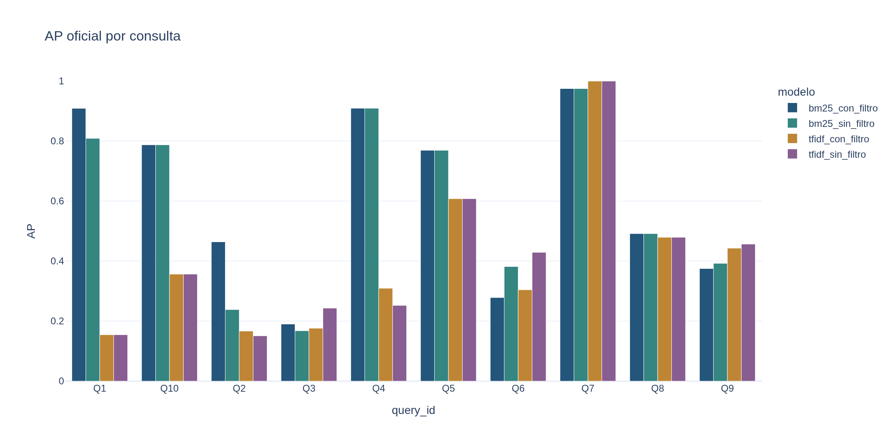
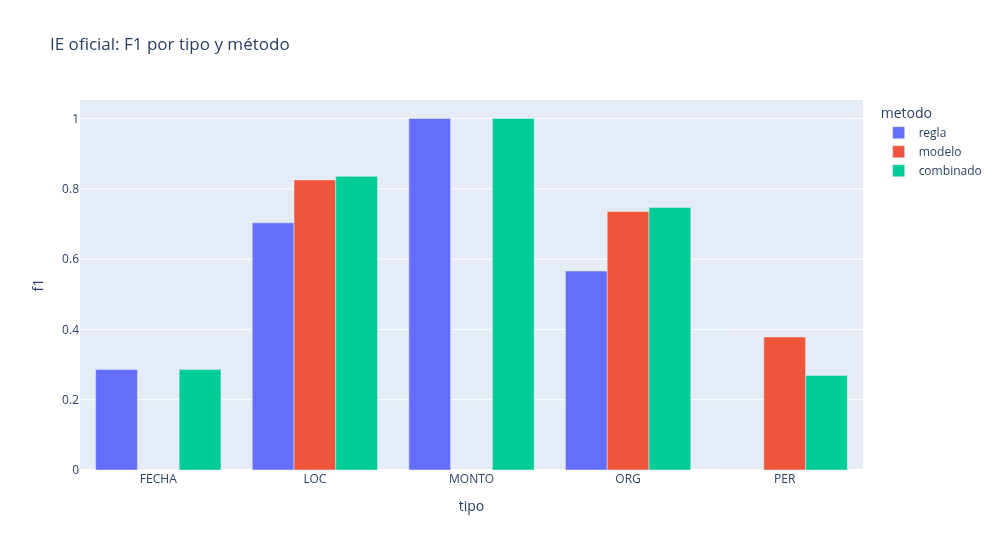

# Examen 1 — Minería de Textos

Luis Alfredo Ramírez Maza

UNAM — FES Acatlán · Licenciatura en Ciencia de Datos

11 de noviembre de 2026

## 1. Portada compacta

[VALIDAR: primer corte, sin prosa]

## 2. Datos, limpieza y segmentación

[VALIDAR: primer corte, sin prosa]

## 3. Preprocesamiento e índice invertido

[VALIDAR: primer corte, sin prosa]

## 4. Ranking y evaluación de IR

[VALIDAR: primer corte, sin prosa]

Tabla: [métricas oficiales IR](tablas/ir.csv).

## 5. Extracción con reglas y con modelo

[VALIDAR: primer corte, sin prosa]

## 6. Evaluación de IE y análisis de errores

[VALIDAR: primer corte, sin prosa]

Tabla: [métricas oficiales por tipo y método](tablas/ie.csv).

## 7. Tablas de respuesta

[VALIDAR: primer corte, sin prosa]

Las [diez tablas completas y valoraciones humanas](../salida/tablas_respuesta/todas.md) permanecen como fuentes. Selección compacta pendiente del primer corte.

## 8. Uso de IA, limitaciones y reproducibilidad

[VALIDAR: primer corte, sin prosa]
